<p align="center">
  
</p>

# 🔥 Omega Vermelho Downloader

<div align="center">


**Um downloader poderoso e eficiente construído com Shell Script**

[🚀 Início Rápido](#início-rápido) • [📖 Documentação](#documentação) • [🐛 Issues](#issues) • [📝 Licença](#licença)

</div>

---

## ✨ Características

- 🚀 **Rápido e Leve** - Construído com Shell Script puro
- 🔒 **Confiável** - Tratamento robusto de erros
- 📦 **Versátil** - Suporta múltiplos tipos de download
- 🎯 **Simples** - Interface intuitiva e fácil de usar
- 💪 **Poderoso** - Funcionalidades avançadas

---

## 🚀 Início Rápido

### Instalação

```bash
git clone https://github.com/OmegaVermelho/deuzimar-downloader.git
cd deuzimar-downloader
chmod +x downloader.sh
```

### Uso Básico

```bash
./downloader.sh [opções] [URL]
```

---

## 📖 Documentação

Para mais informações sobre como usar este projeto, consulte a [documentação completa](./docs).

---

## 🤝 Contribuindo

Contribuições são bem-vindas! Por favor:

1. Faça um Fork do projeto
2. Crie uma branch para sua feature (`git checkout -b feature/AmazingFeature`)
3. Commit suas mudanças (`git commit -m 'Add some AmazingFeature'`)
4. Push para a branch (`git push origin feature/AmazingFeature`)
5. Abra um Pull Request

---

## 🐛 Issues

Encontrou um bug? [Abra uma issue](https://github.com/OmegaVermelho/deuzimar-downloader/issues)

---

## 📝 Licença

Este projeto está licenciado sob a Licença MIT - veja o arquivo [LICENSE](LICENSE) para detalhes.

---

<div align="center">

**Desenvolvido com ❤️ por [OmegaVermelho](https://github.com/OmegaVermelho)**

⭐ Se você gostou deste projeto, considere dar uma estrela!

</div>
